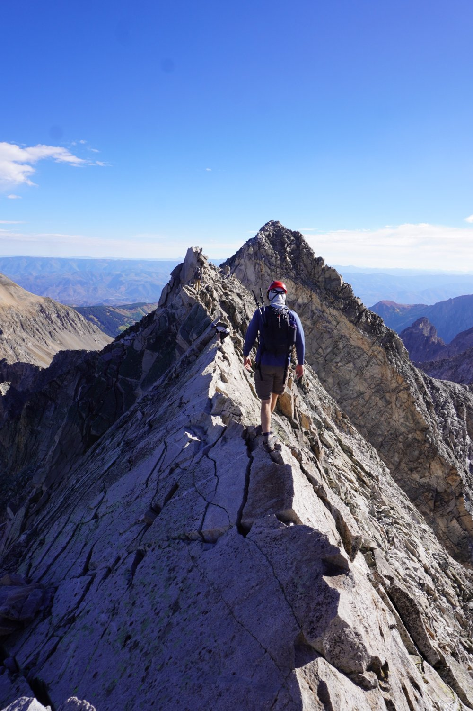
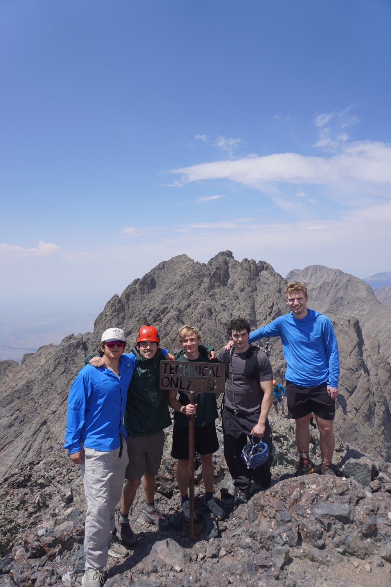
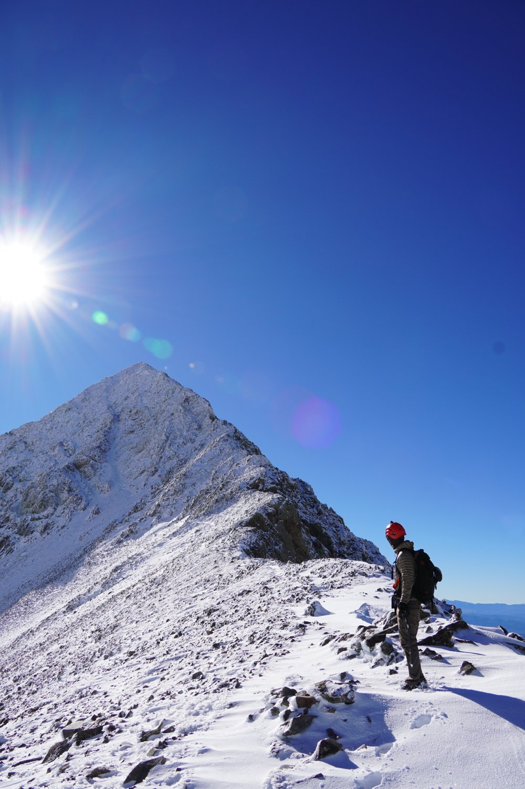
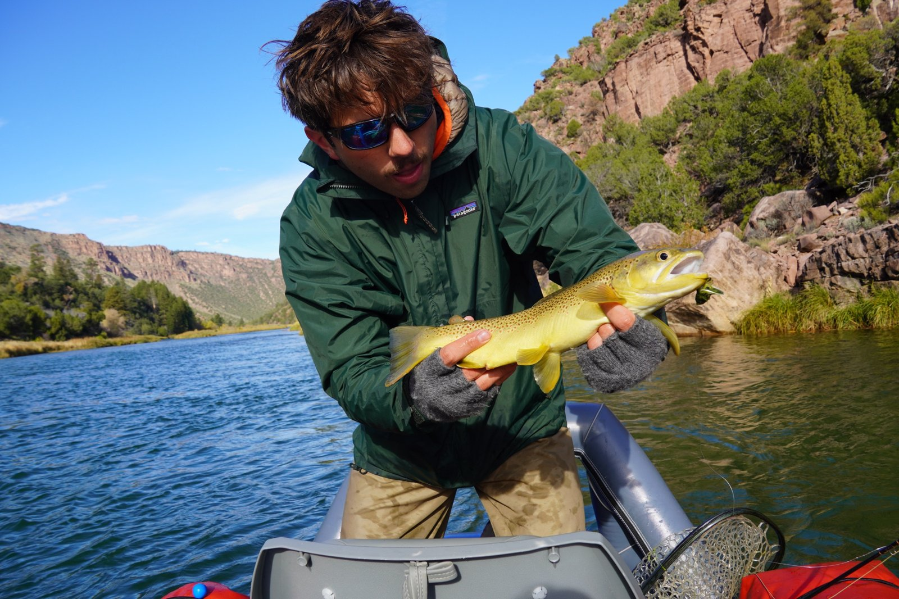
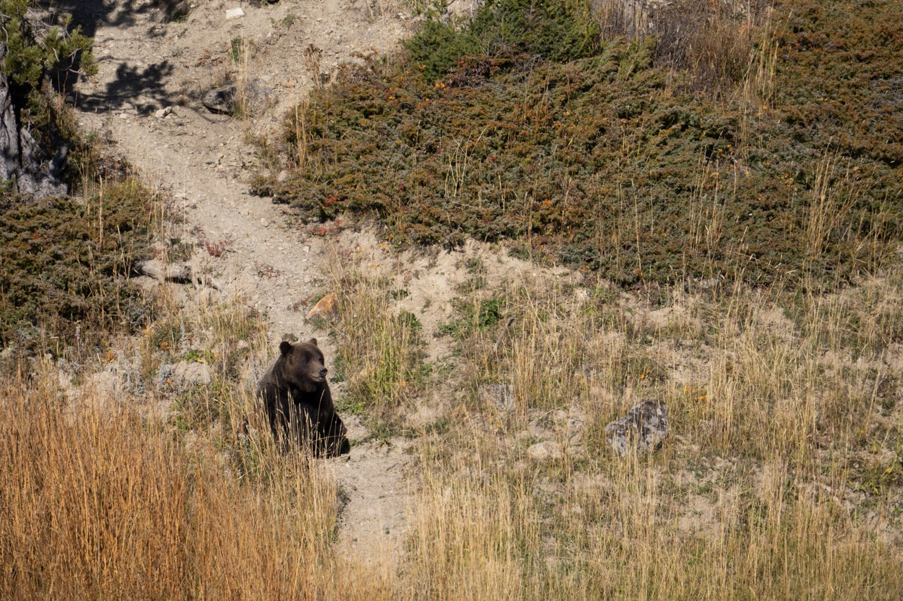
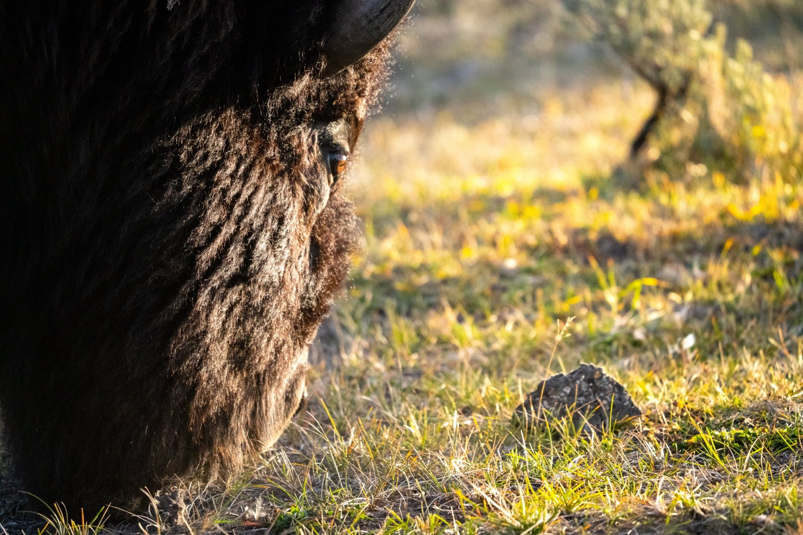
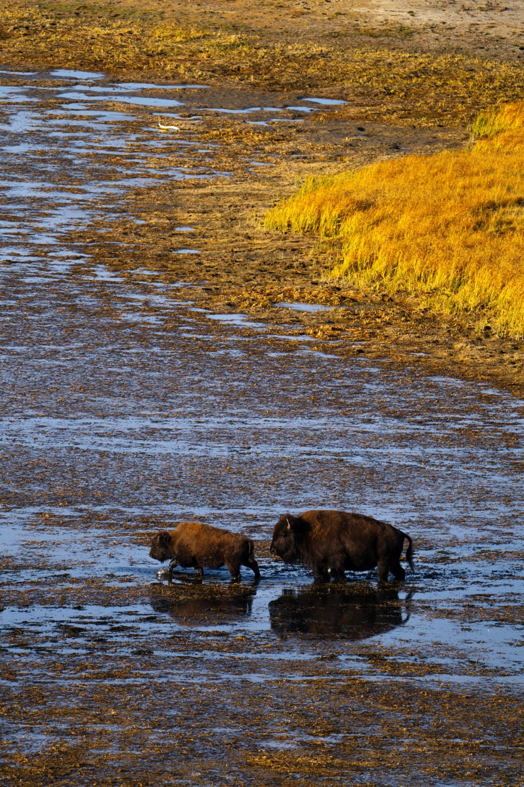
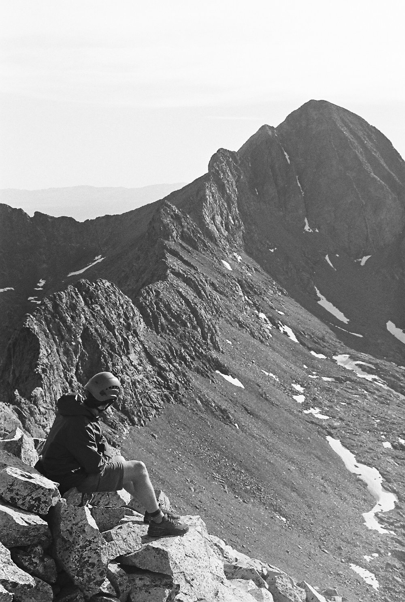

## 🏔️ Chasing All 58 Colorado Fourteeners

My biggest goal outside of work is to stand on top of every one of Colorado's 58 peaks over 14,000 feet.

::: {.peak-progress}

<strong>19</strong> of 58 summited

:::

::: {layout-ncol=3}

:::

I've climbed some of the hardest peaks in the state, including **Capitol Peak**, **Little Bear Peak**, and the Class 5 **Crestone Traverse** between Crestone Peak and Crestone Needle.

**Summited so far:** Quandary · Longs · Bierstadt · Blanca · Ellingwood Point · Little Bear · Sherman · Pyramid · Mt. Blue Sky (Evans) · Torreys · Huron · Princeton · Crestone Peak · Crestone Needle · Democrat · Cameron · Lincoln · Bross · Capitol

### What the mountains have taught me

- **Preparation wins.** Every climb starts days earlier with route research, weather windows, and closure checks. A jobsite runs on the same kind of planning.
- **Know when to turn around.** On exposed terrain, the best decision is sometimes to stop. Safety comes before the schedule, on a mountain or on a jobsite.
- **Trust your team.** On hard routes, you rely on your partners and they rely on you.
- **Big goals are a lot of small ones.** You get to 58 one weekend at a time.

### It even made it into my coursework

My two data projects are built around a fictional 14er guide company. I designed a [relational database](projects/guide-service-database.qmd) to run its trips and [analyzed what drives its prices](projects/guide-pricing-analysis.qmd) in Python. When you care about the subject, the analysis gets a lot more interesting.

## 🌍 Travel

I love to travel, especially with family and friends. During my semester abroad in Prague, I visited **14 countries**. Every new place taught me something about adapting quickly, getting around somewhere unfamiliar, and connecting with people whose language I didn't speak.

## ⛷️ Ski Touring

In the winter, I trade summer trails for skins and skis. Ski touring means climbing up under my own power before skiing down, which takes fitness, avalanche awareness, and good judgment about terrain and conditions.

## 🎣 Fly Fishing

When I'm not on a summit, there's a good chance I'm on a river. Fly fishing is the opposite of a fast-paced day: reading the water, picking the right fly, and waiting for the moment it all comes together.

{width=60% fig-align="center"}

## 📷 Photography

I love photographing **people and wildlife**. Both take patience and an eye for the right moment, whether that's a candid shot of friends on a summit or an animal that only stays still for a second.

::: {layout-ncol=2}

:::

::: {layout-ncol=2}

:::
