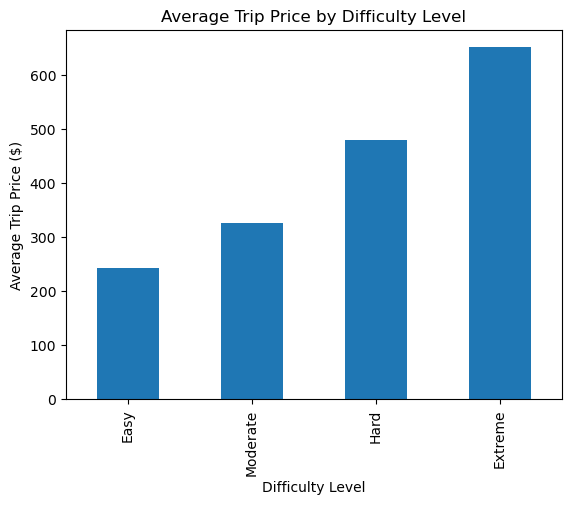
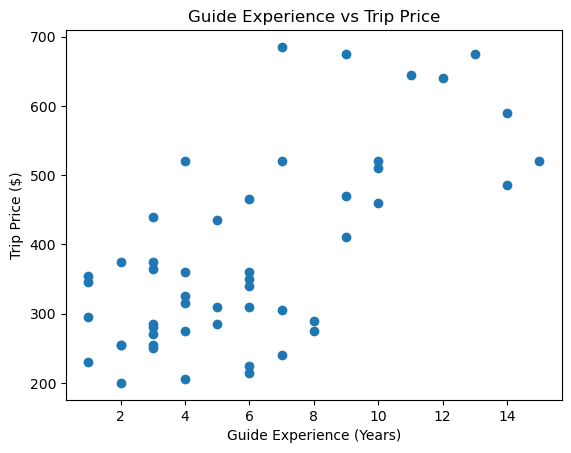
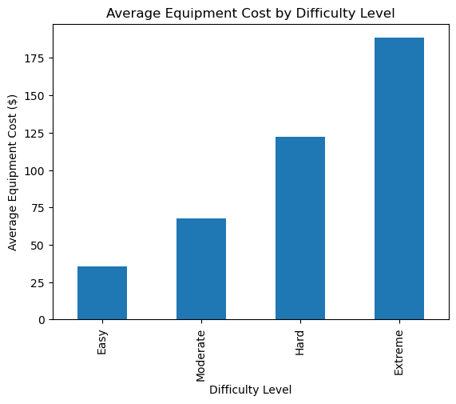

<!-- EDIT: confirm the course name, and adjust the Challenges section to match your experience -->

## The Business Problem

14er Summit Guides, a hypothetical company that leads guided climbs of Colorado's fourteeners, needs to price its trips well. Price too low on hard climbs and it loses money on gear and expert guides. Price too high on easy ones and it loses customers. I set out to find which factors actually drive trip prices and operating costs, using three research questions:

1. Do more difficult mountains have higher average trip prices?
2. Do more experienced guides lead higher-priced trips?
3. Which difficulty level has the highest average equipment cost?

This was my final project for **Automating Business Processes**. It's the analysis side of the same business I built a [relational database](guide-service-database.qmd) for: the database stores the data, and Python turns it into answers.

## My Role & Approach

This was an individual project. I worked in Jupyter with **pandas**, **NumPy**, and **matplotlib**:

1. **Combined two datasets.** I merged trip records with trip details on `TripID` to create one table of 50 trips covering mountain, difficulty, elevation, price, guide experience and certification, group size, and equipment cost.
2. **Profiled the data** with summary statistics for every numeric column and frequency tables for every category.
3. **Answered each question** with grouped averages, correlation analysis, and a chart.
4. **Explored further** with a pivot table and a full correlation matrix.

## Code Highlights

Merging the two data sources into a single table:

```python
import pandas as pd
import numpy as np

trips = pd.read_csv("trips.csv")
trip_details = pd.read_csv("trip_details.csv")
df = pd.merge(trips, trip_details, on="TripID")
```

Average price by difficulty level, sorted so the pattern is easy to see:

```python
avg_price_by_difficulty = (
    df.groupby("DifficultyLevel")["TripPrice"]
    .mean()
    .sort_values()
)
```

Measuring the relationship between guide experience and price:

```python
correlation = df["GuideExperience"].corr(df["TripPrice"])
```

## Results

### 1. Harder mountains cost more, much more

::: {.grid}
::: {.g-col-12 .g-col-md-6}

:::
::: {.g-col-12 .g-col-md-6}
| Difficulty | Avg. trip price |
|---|---|
| Easy | $243 |
| Moderate | $327 |
| Hard | $480 |
| Extreme | **$652** |

An Extreme climb costs about **2.7 times** as much as an Easy one.
:::
:::

### 2. Experienced guides lead higher-priced trips

::: {.grid}
::: {.g-col-12 .g-col-md-6}

:::
::: {.g-col-12 .g-col-md-6}
The correlation between guide experience and trip price is **0.68**, a strong positive relationship. More experienced guides tend to be assigned the harder, higher-priced climbs, or may command higher rates for their expertise.
:::
:::

### 3. Equipment costs climb with difficulty

::: {.grid}
::: {.g-col-12 .g-col-md-6}

:::
::: {.g-col-12 .g-col-md-6}
| Difficulty | Avg. equipment cost |
|---|---|
| Easy | $35 |
| Moderate | $68 |
| Hard | $122 |
| Extreme | **$188** |

Extreme trips need more, and more specialized, gear.
:::
:::

### Going further
A correlation matrix across all numeric variables showed that **equipment cost tracks trip price most closely (0.93)**, the strongest relationship in the data.

## Challenges

<!-- EDIT: replace or adjust these so they reflect what was actually hard for you -->
**Bringing the data together.** The information lived in two separate files, so the first step was merging them on a shared key and checking that all 50 trips matched up with no missing values.

**Correlation isn't causation.** Experience and price move together, but that doesn't prove experience *causes* higher prices. Harder trips may simply get the senior guides. I was careful to frame the findings as relationships, and noted ANOVA and regression as the next step to test them properly.

## Business Value

- **Price by difficulty.** The data supports clear pricing tiers, with each step up in difficulty justifying a meaningful price increase.
- **Put experience where it counts.** Matching senior guides to Hard and Extreme climbs lines up with where the revenue is.
- **Budget gear by trip type.** Equipment cost rises fastest of all with difficulty, so gear investment should follow the mix of harder trips the company sells.

## Why It Matters to Me

Construction bids work the same way: harder, riskier jobs need more experienced people and more equipment, and the price has to reflect that. Being able to back a pricing or staffing decision with data is exactly the skill I want to bring to project management.
