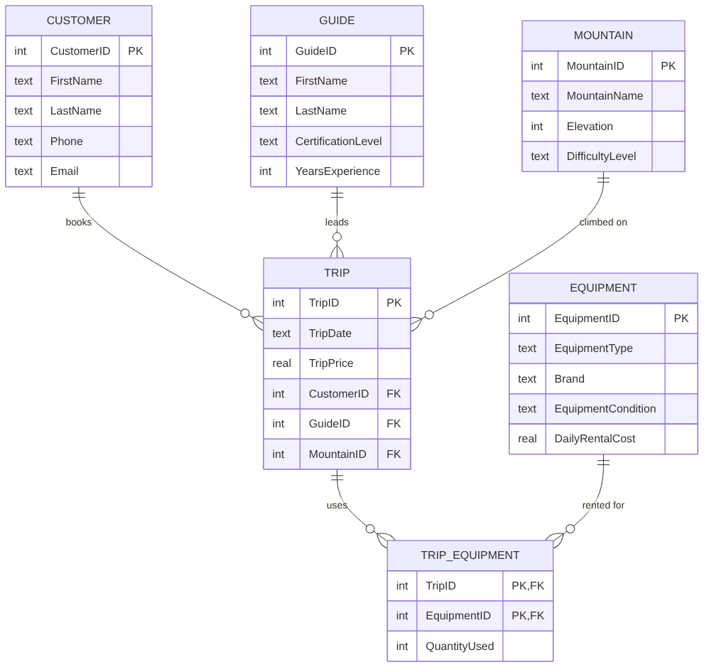

<!-- EDIT: confirm or adjust the business problem, your role, and the challenges so they match your experience -->

## The Business Problem

A guiding company that leads clients up Colorado's 14,000-foot peaks has a lot to keep track of: who booked, which guide is leading, which mountain they're climbing, and what rental gear goes out on each trip. When that information lives in scattered spreadsheets, it's hard to schedule trips, match qualified guides to harder routes, or see which trips and gear actually bring in revenue.

I designed a relational database to bring all of it into one place.

## My Role & Approach

I designed the schema, wrote the SQL to build it, loaded it with sample data in SQLiteStudio, and wrote queries to answer business questions.

1. **Identified the entities** the business runs on: customers, guides, mountains, equipment, and trips.
2. **Made the trip the center of the design.** Each trip links one customer, one guide, and one mountain through foreign keys.
3. **Solved the many-to-many problem.** A trip uses several pieces of gear, and each piece of gear goes out on many trips. A junction table, `TRIP_EQUIPMENT`, records which gear went on which trip and how many.
4. **Enforced data integrity** with primary keys, foreign keys, and `NOT NULL` constraints, so the database rejects a trip booked for a guide or customer who doesn't exist.
5. **Wrote queries** using joins, aggregation, a subquery, and a derived table to turn the data into answers.

## How the Tables Connect



## Code Highlights: Building the Database

The `TRIP` table ties the business together. Each foreign key guarantees that a trip points to a real customer, guide, and mountain:

```sql
CREATE TABLE IF NOT EXISTS TRIP (
    TripID      INTEGER NOT NULL,
    TripDate    TEXT    NOT NULL,
    TripPrice   REAL    NOT NULL,
    CustomerID  INTEGER NOT NULL,
    GuideID     INTEGER NOT NULL,
    MountainID  INTEGER NOT NULL,
    CONSTRAINT TripPK PRIMARY KEY (TripID),
    CONSTRAINT TripCustomerFK FOREIGN KEY (CustomerID)
        REFERENCES CUSTOMER(CustomerID),
    CONSTRAINT TripGuideFK FOREIGN KEY (GuideID)
        REFERENCES GUIDE(GuideID),
    CONSTRAINT TripMountainFK FOREIGN KEY (MountainID)
        REFERENCES MOUNTAIN(MountainID)
);
```

The junction table uses a **composite primary key**, so the same piece of gear can't be logged twice on one trip:

```sql
CREATE TABLE IF NOT EXISTS TRIP_EQUIPMENT (
    TripID       INTEGER NOT NULL,
    EquipmentID  INTEGER NOT NULL,
    QuantityUsed INTEGER NOT NULL,
    CONSTRAINT TripEquipmentPK PRIMARY KEY (TripID, EquipmentID),
    CONSTRAINT TripEquipmentTripFK FOREIGN KEY (TripID)
        REFERENCES TRIP(TripID),
    CONSTRAINT TripEquipmentEquipmentFK FOREIGN KEY (EquipmentID)
        REFERENCES EQUIPMENT(EquipmentID)
);
```

## Code Highlights: Answering Business Questions

### 1. How many trips is each guide leading?
A `LEFT JOIN` makes sure every guide shows up, even one with zero trips. That's how a manager would spot underused staff.

```sql
SELECT G.GuideID, G.FirstName, G.LastName, COUNT(T.TripID) AS NumberOfTrips
FROM GUIDE G
LEFT JOIN TRIP T
ON G.GuideID = T.GuideID
GROUP BY G.GuideID, G.FirstName, G.LastName;
```

**Result:** all 11 guides appear, each currently leading one trip, so the schedule is evenly balanced.

### 2. The full trip roster
A four-table join turns ID numbers into a schedule anyone can read.

```sql
SELECT T.TripID, T.TripDate, C.FirstName AS CustomerFirstName,
       C.LastName AS CustomerLastName, G.FirstName AS GuideFirstName,
       G.LastName AS GuideLastName, M.MountainName
FROM TRIP T
JOIN CUSTOMER C ON T.CustomerID = C.CustomerID
JOIN GUIDE G    ON T.GuideID = G.GuideID
JOIN MOUNTAIN M ON T.MountainID = M.MountainID;
```

| TripID | Date | Customer | Guide | Mountain |
|---|---|---|---|---|
| 501 | 2026-06-10 | Jake Miller | Caleb Brooks | Mount Bierstadt |
| 502 | 2026-06-12 | Emma Davis | Hannah Reed | Grays Peak |
| 503 | 2026-06-15 | Noah Wilson | Tyler Morgan | Torreys Peak |
| … | | | | *(11 trips total)* |

### 3. Which trips are priced above average?
A subquery calculates the average trip price ($311) and filters against it in one statement.

```sql
SELECT TripID, TripDate, TripPrice
FROM TRIP
WHERE TripPrice > (
    SELECT AVG(TripPrice)
    FROM TRIP
);
```

| TripID | Date | Price | Peak (difficulty) |
|---|---|---|---|
| 506 | 2026-06-22 | $400 | Longs Peak (Hard) |
| 509 | 2026-07-01 | **$550** | Capitol Peak (Extreme) |
| 510 | 2026-07-04 | $425 | Mount Sneffels (Hard) |

### 4. What does the rental gear cost on each trip?
A derived table totals quantity × daily rate per trip, then joins back to the trip details.

```sql
SELECT T.TripID, T.TripDate, EquipmentTotals.TotalEquipmentCost
FROM TRIP T
JOIN (
    SELECT TE.TripID, SUM(TE.QuantityUsed * E.DailyRentalCost) AS TotalEquipmentCost
    FROM TRIP_EQUIPMENT TE
    JOIN EQUIPMENT E
    ON TE.EquipmentID = E.EquipmentID
    GROUP BY TE.TripID
) AS EquipmentTotals
ON T.TripID = EquipmentTotals.TripID;
```

**Result:** gear costs range from $14 to **$106 per day**. The most expensive is the Capitol Peak trip, which needs harnesses, ice axes, and crampons.

## Challenges

**Modeling trips and gear.** My first instinct was to store equipment directly on the trip. But a trip can use several items, and each item goes out on many trips, so that design would have meant repeated columns or duplicated rows. Splitting it into a junction table with a composite key kept the data clean.

**Choosing the right keys.** Deciding which table each foreign key belongs in, and making sure every relationship pointed the right direction, took some planning before I wrote any SQL.

## Business Value

- **One source of truth** for bookings, staff, routes, and inventory, instead of scattered spreadsheets.
- **Built-in data quality.** Constraints stop bad records, like a trip with no guide, from ever entering the system.
- **Real answers from the data.** My queries showed that **the only trips priced above average are the three hardest peaks**, and the hardest climb also carries the highest gear cost. Difficulty drives both revenue and equipment demand, which tells the business where to focus marketing, its most experienced guides, and gear investment.
- **Answers in seconds.** Because everything connects through keys, questions like *"Which guides are underused?"* or *"Which gear needs replacing first?"* each take a single query.
- **Room to grow.** New peaks, guides, or gear are just new rows, with no redesign needed.

## Why It Matters to Me

A construction project runs on the same kind of relationships: projects, subcontractors, crews, equipment, and schedules. Learning to model how those pieces connect, and to keep the data trustworthy, is a skill I'll use to keep projects organized.
