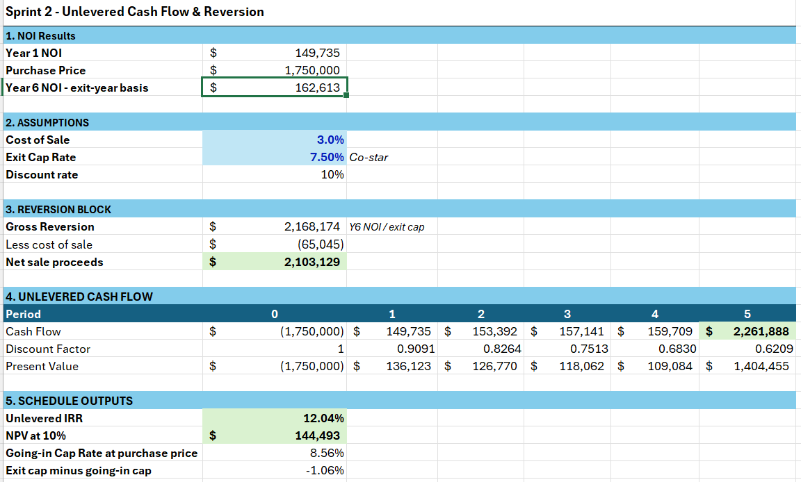
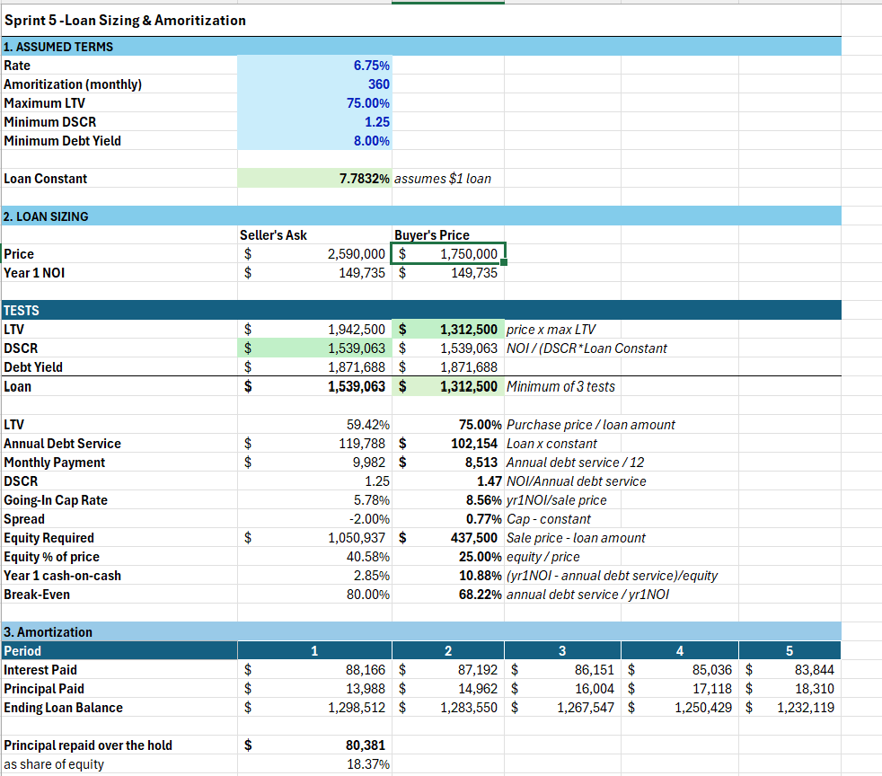
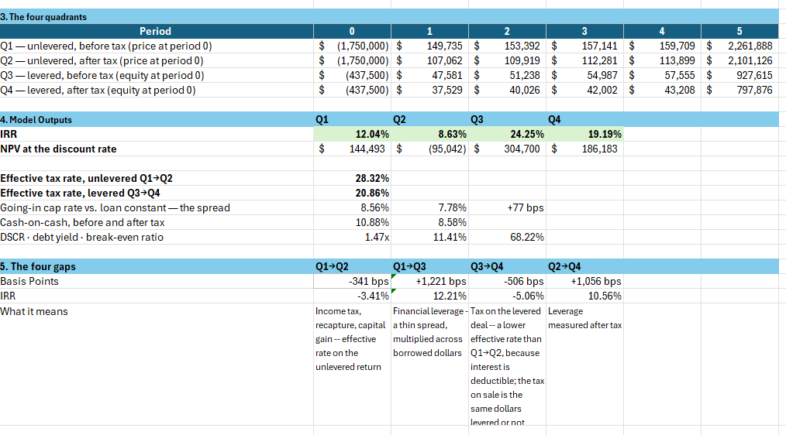

## The Business Problem

A seller is asking **$2.59 million** for a 4,697 SF, three-tenant restaurant property in central Denver. Should an investor buy it, and if so, at what price?

In Income Property Finance, our team built a full acquisition model to answer that question, from the rent roll all the way to a walk-away price.

## My Role & Approach

This was a team project, and I was hands-on in every stage of the model. We built it in eight stages, each one feeding the next:

1. **Rent roll and 6-year NOI schedule**, with each tenant's lease escalations and a 3% vacancy and credit loss
2. **Unlevered cash flow and sale proceeds**, using a 7.5% exit cap rate sourced from CoStar
3. **Depreciation**, with an 80/20 land-to-building split and 39-year cost recovery
4. **After-tax cash flows**, including depreciation recapture and capital gains tax on the sale
5. **Loan sizing**, testing LTV, DSCR, and debt yield, for a $1.31M loan at 6.75% amortized over 30 years
6. **Four-quadrant returns**: unlevered and levered, each before and after tax
7. **Risk testing**: break-even exit cap, the impact of losing each tenant, and a tornado sensitivity analysis
8. **Lease rollover scenario**: what happens if one restaurant tenant leaves when its lease expires in 2030, using CoStar data for downtime, free rent, and renewal probability

### Inside the model
*Click any screenshot to enlarge it.*

## Key Results

| Measure | Result |
|---|---|
| Going-in cap rate | 8.56% |
| Unlevered IRR at our $1.75M price | 12.0% |
| Unlevered IRR at the seller's $2.59M ask | **2.4%** |
| Loan | $1.31M · 75% LTV · 1.47× DSCR |
| Walk-away price (probability-weighted) | **≈ $1.87M** |

### The four quadrants

| | Before tax | After tax |
|---|---|---|
| **Unlevered** | 12.0% | 8.6% |
| **Levered** | 24.3% | 19.2% |

## Challenges

**The four quadrants were the hardest part.** Each quadrant uses a different cash flow stream, and they all have to tie back to the same NOI and sale proceeds. In the levered after-tax case, only the interest on the loan is deductible, not the principal. The tax on the sale is the same dollars whether or not the deal uses debt. Getting all four to reconcile took several passes.

**Tenant concentration.** With only three tenants, there's very little margin for error. Losing either of two tenants on its own drops the debt service coverage ratio below 1.0×, which means the property would no longer cover its mortgage.

**Modeling a lease rollover.** We modeled one tenant's lease expiration month by month: downtime while the space sits empty, free rent for a new tenant, tenant improvements, and leasing commissions. In that downside case, the loan's DSCR covenant is breached in year five.

<!-- EDIT: adjust the challenges so they match your experience -->

## Business Value

The model turned "is this a good deal?" into a clear negotiating position:

- **At the asking price, the deal doesn't work.** It returns only 2.4% unlevered, well below a 10% required return.
- **The most an investor should pay is about $1.87 million**, roughly **$720K below the ask**, after weighting the chance that a key tenant leaves.
- **Leverage doubles the return** (12.0% to 24.3%), but tenant concentration is the risk to watch.

## Why It Matters to Me

As a future construction manager, this project showed me how owners decide whether a project pencils out. It also showed me why tenant improvement budgets, lease-up time, and schedule delays matter so much to them. Those numbers are what the people I'll build for are looking at.
